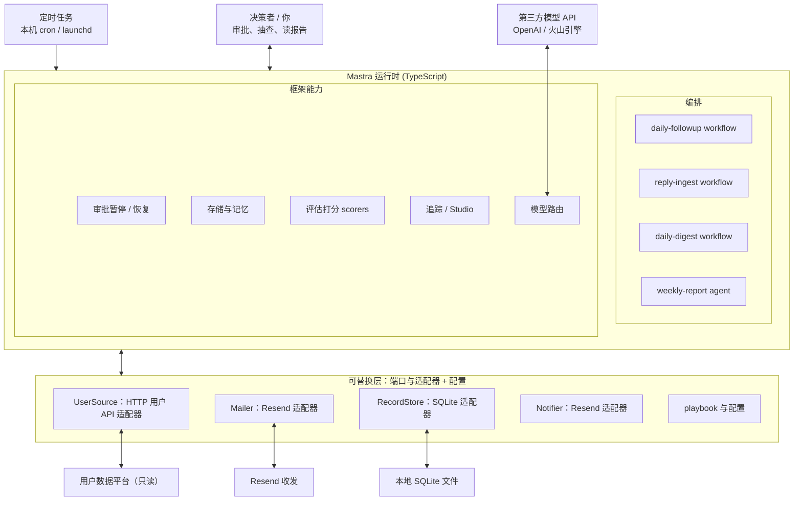

# 01 架构

## 设计原则
1. 固定流程为主，agent 只用于开放问题（周报洞察）。
2. 核心通用：循环、编排、审批、记录、评估由框架和 `core/` 提供；平台差异放适配器，业务差异放 playbook。
3. 人只做决策：审批高风险动作、抽查、读报告、定方向。
4. 默认安全：dry-run、审批闸、隐私隔离、运行上限。
5. 先本机，后迁移：MVP 在本机运行，架构不依赖具体运行环境。

## 架构图

## 分层说明

| 层 | 内容 | 由谁提供 | 是否可替换 |
|---|---|---|---|
| 触发 | cron / launchd 调用 CLI 入口 | 操作系统 | 可迁移到 Cloudflare Cron |
| 运行时 | agent、workflow、审批暂停恢复、存储、评估、追踪、模型路由 | Mastra | 框架本身可换，需重写 `src/mastra/` |
| 核心 | domain 类型、ports 接口、privacy、guards、playbook 加载 | 本项目（通用） | 否 |
| 适配器 | UserSource / Mailer / RecordStore / Notifier 的具体实现 | 本项目（平台相关） | 是 |
| 配置 | playbook、标签、报告模板、环境变量 | 本项目（业务相关） | 是 |
| 外部 | 用户数据平台、Resend、模型 API、SQLite 文件 | 第三方 | 是 |

## 日常数据流（每日一次）
1. launchd / cron 调用 `schedule:tick`，检查工作日 09:00（Asia/Taipei）计划；当前分钟内原子创建 daily-followup 运行，错过则记录跳过，不补跑。`job:daily` 保留为人工立即发起。
2. `reply-ingest`：从 Mailer 拉取新回复 → `redact()` → 抽取结构化 insight → 写入 RecordStore。
3. `daily-followup`：UserSource 取流失名单 → 排除已联系 → 截断到 `MAX_USERS_PER_RUN` → 逐用户：构建匿名上下文 → 分类 → 写草稿 → 护栏检查 → 存为 `pending_approval` → 暂停等待审批。
4. 人通过 `pnpm approve` 审批（可编辑）；恢复后 `SendService` 取联系方式并经 Mailer 发送（受 `SEND_MODE` 约束）。
5. `daily-digest`：用代码聚合当日记录，生成日汇总，经 Notifier 发给决策者。

## 周报数据流（每周一次）
1. cron 触发 `job:weekly`。
2. `weekly-report agent` 通过只读工具查询结构化记录与聚合，自主决定深挖哪些主题。
3. 按 playbook 的报告模板生成周报 → 默认先发给你审阅，确认后再发决策者（MVP 可配置为直接发送）。

## 隐私边界
- 进入模型的数据：opaque userId、匿名行为特征、已 `redact()` 的回复文本。
- 不进入模型：邮箱、姓名、电话等联系方式。联系方式仅在 `SendService` 发送瞬间获取。
- 日志不记录 prompt 全文中的用户原始回复之外的 PII；追踪数据同样受此约束。

## 关键决策与理由
- 日常回访用固定 workflow：量小、流程确定，成本低且可控；agent 的自主性只留给周报。
- 审批用 workflow 的暂停与恢复：这是框架的核心能力，也是学习重点。
- 回复接收用轮询：本机没有公网地址，无法收 webhook；定时拉取足够。
- 存储用 SQLite（libSQL）：零运维，Mastra 存储和业务记录可共用。
