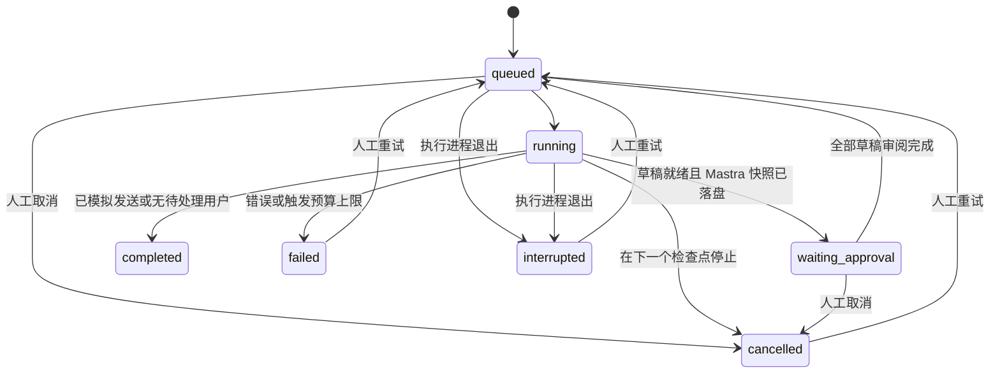

# 08 运行状态与 UI

## 本轮确认的范围

用户确认使用 React + Vite + TypeScript；M0 提前实现 mock 审批、编辑、拒绝与模拟发送；失败、中断或取消后人工重试，不自动恢复运行。原规格对管理 UI 的排除已被本次要求替代。真实 API、真实模型、真实邮件、回复抽取、报告仍按 M1–M4 分阶段实现。

## 三层状态

运行、步骤与草稿分别表达不同对象，不把“生成完草稿”显示为“整个任务成功”。

| 运行状态 | 含义 | 可操作项 |
|---|---|---|
| queued | 已持久化、即将执行；或最后一项审批已完成 | 停止 |
| running | 某个步骤正在执行 | 请求停止 |
| waiting_approval | Mastra 已 suspend，当前无模型调用 | 编辑、批准、拒绝、停止 |
| completed | 全部草稿已拒绝或已模拟发送，或没有符合条件的用户 | 查看 |
| failed | 错误、护栏拒绝或预算上限导致终止 | 查看、人工重试 |
| cancelled | 人工停止，已保留结果与事件 | 查看、人工重试 |
| interrupted | 原执行进程已退出，未主动恢复 | 查看、人工重试 |

步骤：发现用户 → 匿名上下文 → 分类 → 草稿 → 护栏 → 人工审批 → 模拟发送 → 完成。前五步对每位用户串行执行；UI 的步骤条表示当前用户正在执行的阶段，草稿计数表示整个批次的进度。事件保存每一次步骤切换、当前匿名用户和结果，不展示模型私有推理链。

草稿：`pending_approval → approved | rejected`；`approved → simulated`。`simulated` 永远不等同于真实 `sent`。护栏失败的内容不会保存为草稿或进入审批队列；运行状态和带匿名用户 ID 的事件记录失败。运行中的失败、取消不会删除此前草稿。

## 暂停、恢复与重试

- M0 使用 Mastra `createWorkflow/createStep/suspend/resume`，workflow snapshot 保存在独立的 SQLite 文件。业务记录和快照的生命周期分开管理。
- 只有 Mastra 返回 `suspended` 并完成快照持久化后，业务运行才标记 `waiting_approval`，避免 UI 过早开放审批。
- UI 和 CLI 每次审阅都在 SQLite 写事务中检查运行状态、草稿版本与审批状态，并再次执行护栏；审阅前后文本写入 `human_edits`。拒绝按钮保留原文；CLI 可用编辑后批准。
- 最后一项审阅把运行状态原子更新为 `queued`；只有赢得该更新的调用者执行 `resume`。Mastra 审批步骤仍检查数据库，不信任客户端传来的“已审阅”声明。
- 等待审批不是进程中断，重启后原队列保持可用。启动仅对 owner PID 已不存活的 queued/running 记录标记 interrupted，不触发自动重试。
- 手工重试沿用业务运行 ID、增加 attempt、创建新的 Mastra run；保留原事件和审批，跳过已生成草稿，模拟凭据按草稿 ID 幂等写入。不会重新联系已被其他运行占用的用户。
- 调用次数跨重试累计；修改环境变量并重启后，重试使用当前上限。降低上限导致已选用户超限时拒绝重试。
- 停止为协作式：正在等待的调用返回后，在下一个检查点停止；不会回滚已经生成的草稿或已完成的模拟发送。M1 的模型调用支持 AbortSignal 与超时；中止不保证供应商未计费，未知用量保留预留。
- 单机 PID 检查是 M0 的进程存活机制，不提供跨机器租约；机器迁移和进程身份复用的增强留入 backlog。

## 并发与持久化

业务库以唯一部分索引保证一次一个活动任务；SQLite 事务保证更新状态与记录关联的一致性；run_id/draft_id 都是普通 ID 字段，没有外键。应用层创建草稿前确认父运行存在，编辑前确认草稿属于当前运行。

运行历史界面返回最近 100 次，详情事件保留完整记录。用户处理与模拟调用本身受硬上限约束。UI 每秒串行刷新一次；服务不可达会显示连接错误，不把旧数据伪装成新结果。

## UI 结构

| 页面 | 职责 |
|---|---|
| 工作台 | 本次用户/草稿/模拟发送/调用统计、运行步骤、进度、近期事件、草稿预览 |
| 草稿审批 | 选择运行、筛选草稿、编辑与批准、拒绝、原始草稿与人工记录 |
| 运行记录 | 最近运行状态、尝试次数、用量、进入详情 |
| 业务手册 | 两套示例业务的目标、分类、话术护栏 |

页面始终标记 dry-run，并区分虚构用户来源和真实 AI / stub 模型；窄屏收缩为图标导航，保留可访问名称。表单有标签，创建使用原生 dialog，支持键盘关闭与焦点约束；审批中禁用重复操作，后端仍独立做版本校验。

## HTTP 约定

服务只监听 `127.0.0.1`，校验 Host 和 Origin，写请求必须是 JSON，正文上限 16 KiB；错误只返回稳定的错误代码，不回显请求正文、密钥或底层堆栈。成功开始/重试返回 202；输入问题 400，状态冲突 409；完整结构见 `api.openapi.json`。本阶段不包含登录、多租户或公网发布。

## 官方 API 参考

实现时核对了 Mastra 当前官方文档：[Workflow](https://mastra.ai/docs/workflows/overview)、[Step](https://mastra.ai/reference/workflows/step)、[Resume](https://mastra.ai/reference/workflows/run-methods/resume)、[libSQL](https://mastra.ai/integrations/databases/libsql)。实际依赖版本锁定在 `pnpm-lock.yaml`。

## M1 模型运行补充

真实 AI 接入采用独立 MODEL_MODE。运行保存模型配置快照与逐次调用预算，用量面板显示真实调用、已确认输入/输出 token、估算费用及未确认预留。旧 M0 历史按 stub 展示；更换模型后不允许重试旧模型任务。细节见 `10-ai-integration.md`。
