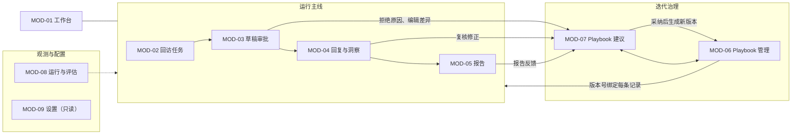

# 09 平台业务模块划分

## 产品定位
面向一个人的本机运营工具：把回访从发现、审批、发送、回复，到总结、汇报、规则迭代串成闭环。产品形态为**控制台**；MVP 起即提供本机网页控制台作为主要入口，CLI 保留为定时任务入口与备用。

## 角色

| 角色 | 说明 | 主要使用的模块 |
|---|---|---|
| 操作者 | 你本人，同时是审批人与 playbook 审批人 | 全部 |
| 决策者 | 读汇报，可给反馈 | 报告（通过邮件收到；控制台仅操作者使用，反馈由操作者代为录入） |
| 系统 | 调度、agents、workflows | 不直接使用界面 |

## 模块地图

## 模块清单

说明：各模块的「MVP 形态」给出的是 CLI 命令，它们继续保留，作为备用与自动化入口；控制台页面是主要入口，对应线框见 `10`。

### MOD-01 工作台
- 目的：一眼看到今天的状态和待办。
- 内容：今日概况计数、待办（待审批、待复核、待审阅建议、待确认周报）、最近运行、异常。
- 操作：跳转到对应模块；重试失败项。
- MVP 形态：`pnpm status`。

### MOD-02 回访任务
- 目的：查看每个流失用户的回访全过程。
- 对象：FollowupRecord（匿名用户 ID、分类标签与置信度、状态、playbook 版本、时间线）。
- 操作：筛选、查看详情时间线。不展示邮箱和姓名。
- MVP 形态：`pnpm followups -- list|show <id>`。

### MOD-03 草稿审批
- 目的：人工把关所有对外发送。
- 对象：Draft（主题、正文、护栏结果、原始版本与编辑版本、拒绝原因）。
- 操作：批准、编辑后批准、拒绝（原因码）、跳过。护栏失败的草稿不可批准。
- MVP 形态：`pnpm approve`（逐条交互）。

### MOD-04 回复与洞察
- 目的：查看回复及结构化抽取结果，复核并修正。
- 对象：Reply（已脱敏）、Insight（摘要、标签、证据、置信度）。
- 操作：确认、修正标签、标记不准确（原因码）。低置信度与「其他」类优先展示。
- MVP 形态：`pnpm replies -- list|show|review <id>`。

### MOD-05 报告
- 目的：生成并阅读日汇总、周报，确认后发给决策者，收集反馈。
- 对象：Report（结构按 playbook 的报告模板）、ReportFeedback。
- 操作：阅读、展开证据、确认并发送（`REPORT_REVIEW_FIRST=true` 时）、记录反馈。
- MVP 形态：报告写入 `out/reports/` 并经邮件发送；`pnpm report -- show|send|feedback`。

### MOD-06 Playbook 管理
- 目的：查看与管理当前规则及其版本历史。
- 对象：PlaybookVersion。
- 操作：查看当前内容与历史、对比两个版本、手动编辑（必须填写变更说明）、回滚。受限文件显示为「仅人工可改」。
- MVP 形态：`pnpm playbook -- show|history|diff <a> <b>|rollback <v>`。

### MOD-07 Playbook 建议
- 目的：审阅 AI 提议的修改（详见 `08`）。
- 对象：PlaybookProposal、证据、RegressionReport。
- 操作：采纳、修改后采纳、拒绝、搁置；查看观察清单。
- 形态：M6 `pnpm playbook:propose`、`pnpm playbook:review`，并在控制台提供建议列表与详情页。

### MOD-08 运行与评估
- 目的：了解系统是否健康、花了多少钱、效果如何。
- 对象：Run（任务、状态、耗时、模型调用数、token、估算成本）、评估结果（按 playbook 版本分组）。
- 操作：查看运行详情与追踪、重试失败运行、查看预算使用。
- MVP 形态：`pnpm runs -- list|show|retry <id>`、`pnpm eval`。

### MOD-09 设置（只读）
- 目的：确认当前配置，避免误操作。
- 内容：适配器档位、playbook、三档模型、发送模式、白名单、收件人、各项上限。
- 约定：不在界面修改。修改需编辑 `.env` 并重启（安全原因，尤其是发送模式）。
- MVP 形态：`pnpm config:show`（密钥只显示是否已配置）。

## 对象与模块读写矩阵

| 对象 | 回访任务 | 草稿审批 | 回复与洞察 | 报告 | Playbook | 建议 | 运行与评估 |
|---|---|---|---|---|---|---|---|
| FollowupRecord | 读 | 读写 | 读 | 读 | | | 读 |
| Draft | 读 | 读写 | | | | 读 | |
| Reply / Insight | | | 读写 | 读 | | 读 | |
| Report / Feedback | | | | 读写 | | 读 | |
| PlaybookVersion | | | | | 读写 | 读写 | 读 |
| Proposal / Regression | | | | | 读 | 读写 | 读 |
| Run / EvalResult | | | | | | | 读写 |

## 实现约定
- 所有人工操作封装在 `core/services`，CLI 和控制台共用，UI 层不写业务逻辑。
- 所有写操作记录审计日志（谁、何时、什么、前后状态）。
- 联系方式只以掩码形式展示（如 `j***@example.com`），完整地址只在发送瞬间由 SendService 取得。
- 顶栏常驻显示发送模式与当前 playbook 版本。
- MVP：单用户本机；控制台只监听 `127.0.0.1`；若迁移 Cloudflare，再用 Cloudflare Access 做访问控制。

## 通知（MVP 范围）
不做独立通知系统。日汇总邮件末尾附「待办摘要」（待审批数、待复核数、新建议数、失败项），运行失败与超预算时给操作者发一封提醒邮件。
